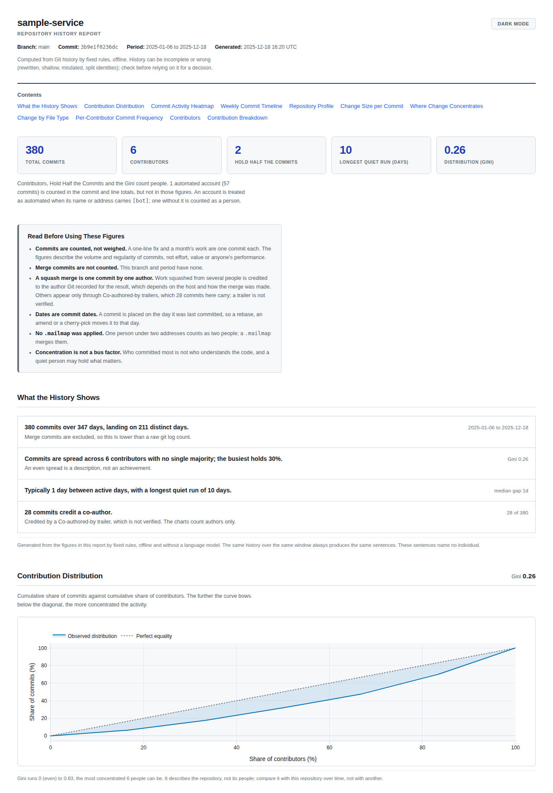
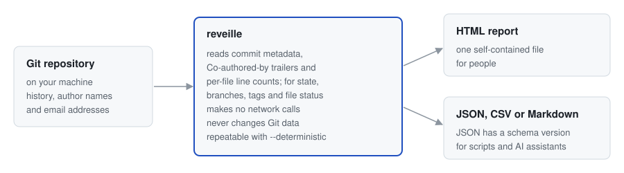
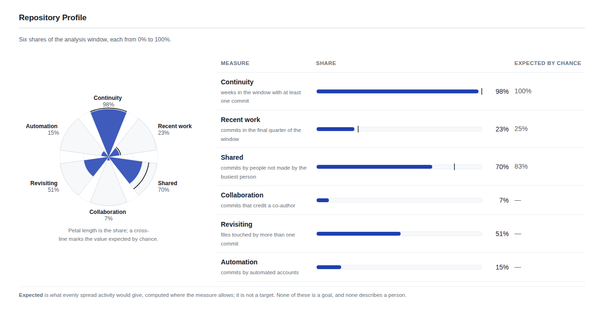

# Reveille

**Offline reports of a Git repository's commit activity.**
Reveille reads a local clone and writes a single HTML report, and answers scripts, CI and coding
agents in JSON: where the repository stands, and what changed since a tag or a date. It never
changes Git data and makes no network calls.

[](https://pypi.org/project/reveille/)
[](https://pypi.org/project/reveille/)
[](https://github.com/varaprasadchilakanti/reveille/blob/main/LICENSE)
[](https://github.com/varaprasadchilakanti/reveille/actions/workflows/ci.yml)
[](https://www.bestpractices.dev/projects/14502)
[](https://codecov.io/gh/varaprasadchilakanti/reveille)

```bash
pipx install reveille
cd /path/to/repository
reveille generate     # writes the HTML report
reveille summary      # commit counts and spread, as text
```

Run on the sample repository pictured below (invented contributors),
`reveille summary --deterministic` prints:

```text
sample-service (main), 2025-01-06 to 2025-12-18
380 commits by 6 authors and 1 automated account; Gini 0.26, longest quiet run 10 days.
- 380 commits over 347 days, landing on 211 distinct days.
- Commits are spread across 6 contributors with no single majority; the busiest holds 30%.
- Typically 1 day between active days, with a longest quiet run of 10 days.
- 28 commits credit a co-author.
Computed from Git history by fixed rules, offline. History can be incomplete or wrong (rewritten, shallow, misdated, split identities); check before relying on it for a decision.
```

<picture>
  <source media="(prefers-color-scheme: dark)" srcset="https://raw.githubusercontent.com/varaprasadchilakanti/reveille/main/docs/images/report-dark.png">
  
</picture>

*A report for a sample repository with invented contributors, built by
[`docs/images/make_sample_repository.py`](https://github.com/varaprasadchilakanti/reveille/blob/main/docs/images/make_sample_repository.py)
and rendered with `reveille generate --deterministic`.*

**For coding agents.** `reveille skill >> AGENTS.md` adds a short section to the agent's
instructions file. `state`, `brief`, `summary` and `who-changed` answer with `--format json`; each
JSON document carries a `schema_version`. Exit `1` is a negative answer and `2` means it could not
run ([exit codes](https://github.com/varaprasadchilakanti/reveille/blob/main/docs/USER_GUIDE.md#exit-codes)).
[`llms.txt`](https://github.com/varaprasadchilakanti/reveille/blob/main/llms.txt) indexes the
documentation.

It reads clones from GitHub, GitLab, Bitbucket or a self-hosted server; SHA-256 repositories and
partial clones are refused. The report shows a commit calendar heatmap, weekly activity, how
commits are spread across contributors, where change concentrates and a per-contributor table; the
figures are also JSON or CSV. `state`, `brief`, `summary` and `who-changed` answer single questions
as text or JSON; the first three also give Markdown, and `state` and `brief` one line.

**Properties.** Designed and tested on every change, not a warranty.
[SECURITY.md](https://github.com/varaprasadchilakanti/reveille/blob/main/SECURITY.md)
covers the threat model and how to verify a release.

- No network call. The report loads no remote resource and opens offline.
- No change to Git data. History, refs, index, objects and configuration are left as they are, and
  an output path inside the repository's Git directory is refused.
- Git runs with signature checking, fsmonitor and (for `state`) repository-defined content
  filters switched off. A plain `git status` runs the last two.
- With `--deterministic`, an unchanged repository produces a byte-identical report on the same
  Reveille version, installed dependencies and Git settings.

Limits: Reveille switches off only the Git settings its reads were found to use, so a repository
whose `.git` came from someone else may still run one. `git clone` does not copy `.git/config`; a
copied directory or an archive does. Refused: a partial clone (`git clone --filter`), because
reading it would make Git fetch; a SHA-256 repository, for now, because the library Reveille reads
it with cannot parse its references; and a repository whose `.git/config` sets `core.worktree` to
another directory, since the report would describe that directory and be written into it.

**What it is not**

- Not an evaluation of people. It counts commits and changed lines, which does not measure anyone's
  contribution, productivity or value.
- Not a ranking unless you ask: it needs `--ranking`, and the report then states what the score
  measures and what it does not. JSON and CSV always carry a `rank` column, in table order (by
  commits; by score with `--ranking`).
- Not anonymised. A report names the people in the history, with their activity and their email
  addresses unless you pass `--hide-emails` (which leaves the names). [What the report contains about people](https://github.com/varaprasadchilakanti/reveille/blob/main/docs/USER_GUIDE.md#what-the-report-contains-about-people)
  lists it field by field, and [Before you share a report](https://github.com/varaprasadchilakanti/reveille/blob/main/docs/USER_GUIDE.md#before-you-share-a-report)
  says what to check.
- Not a bus factor. Commit concentration says who committed, not who understands the code.
- Not every commit. Merge commits are excluded, so counts are lower than `git log` shows; the JSON
  says how many were left out (`merge_commits_excluded`).

<picture>
  <source media="(prefers-color-scheme: dark)" srcset="https://raw.githubusercontent.com/varaprasadchilakanti/reveille/main/docs/images/how-it-fits-dark.svg">
  
</picture>

---

## Contents

- [What It Answers](#what-it-answers)
- [Installation](#installation)
- [Quickstart](#quickstart)
- [In CI: GitHub Actions](#in-ci-github-actions)
- [Reading the Report](#reading-the-report)
- [Commands](#commands)
- [Contributor Ranking](#contributor-ranking)
- [Documentation](#documentation)
- [Contributing](#contributing)
- [Legal and Privacy](#legal-and-privacy)
- [Licence](#licence)

---

## What It Answers

- When work happened, how concentrated it is and who changed a file, answered on the machine that
  holds the clone.
- Figures that can be recomputed: `--deterministic` gives the same bytes, and the JSON records the
  analysed commit and the options used. The
  [Playbook](https://github.com/varaprasadchilakanti/reveille/blob/main/docs/PLAYBOOK.md#for-an-audit-or-due-diligence)
  says what history is and is not evidence of.
- Single questions from a script or an AI assistant through `state`, `brief`, `summary` and
  `who-changed`: JSON on stdout, a declared schema version, and exit codes that separate "no" from
  "could not run". `summary --format json` and `brief` name no contributor, but `summary` carries
  the repository and branch names, and with one or two people counts can identify someone.
  `generate --format json --output -` prints names and email addresses, which leave your machine if
  given to a hosted model. To tell a coding agent about these, see [`reveille skill`](#commands).

Its figures do not support judging people; see [Contributor Ranking](#contributor-ranking).

---

## Installation

Needs Python 3.11 or later and Git 2.24 or later (older Git is refused with exit 2).

```bash
pipx install reveille      # or: uv tool install reveille, or pip install reveille
reveille --version
```

Two names for one command are installed, `reveille` and `reile`; if another tool owns either, use
`python -m reveille`. To run once without installing: `uvx reveille summary`. To remove, use the
installing tool (`pipx uninstall reveille`, `pip uninstall reveille` or `uv tool uninstall reveille`).
Reveille keeps no cache or settings.

---

## Quickstart

```bash
cd /path/to/your/repository
reveille generate
```

This writes `reveille-report.html` in the repository root; open it in any browser, no network
needed. The file is untracked, so `git add -A` would commit it, names and addresses included: add it
to `.gitignore`, or write it elsewhere with `--output`. The header, summary cards, findings,
repository profile and contributor table are plain HTML; the other charts need JavaScript.

```bash
reveille generate --since 2024-01-01 --until 2024-12-31   # a date range
reveille generate --output /tmp/q4-report.html            # another path (outside the repository: written, with a warning)
reveille generate --repo /path/to/repository              # another repository
reveille init                                             # write an annotated reveille.toml
```

`reveille init` writes a `reveille.toml` with every key commented out. `reveille generate`, run from
that directory, then loads it and announces any setting it applies.

---

## In CI: GitHub Actions

A weekly report, kept as a build artifact, with the summary on the run's page:

```yaml
name: Repository history report
on:
  workflow_dispatch:
  schedule:
    - cron: "0 6 * * 1"
permissions:
  contents: read
concurrency:
  group: reveille-report
  cancel-in-progress: true
jobs:
  report:
    name: History report
    runs-on: ubuntu-latest
    steps:
      - uses: actions/checkout@3d3c42e5aac5ba805825da76410c181273ba90b1 # v7.0.1
        with:
          fetch-depth: 0 # the whole history; the default, 1, is a single commit
          persist-credentials: false
      - run: pipx run reveille generate --output reveille-report.html
      - run: |
          { echo '```'; pipx run reveille summary; echo '```'; } >> "$GITHUB_STEP_SUMMARY"
      - uses: actions/upload-artifact@cf430e030ddbb5b0abf93d22962f4752f3646cd9 # v7.0.2
        with:
          name: reveille-report
          path: reveille-report.html
          retention-days: 7
```

Set `fetch-depth: 0`: with the default of one commit, the report covers one commit, and says so.
The report lists contributors' names and email addresses, and anyone who can read the repository's
Actions runs can download the artifact; on a public repository that is everyone. GitLab CI needs
`GIT_DEPTH: 0` for the same reason.

---

## Reading the Report

Findings first, evidence after: header and summary cards (window, commits, people, how many hold
half the commits, longest quiet run, Gini coefficient); written findings that name nobody; a Lorenz
curve of how evenly commits are spread; the commit-activity heatmap and weekly timeline; the
repository profile; change size, hotspots and file types; then per-contributor figures. Automated
accounts (`[bot]` in the name or address) are counted in commit totals and stated apart, not counted
as people.

<picture>
  <source media="(prefers-color-scheme: dark)" srcset="https://raw.githubusercontent.com/varaprasadchilakanti/reveille/main/docs/images/profile-dark.png">
  
</picture>

Two sections appear only when asked for: **Who Changed Each Area** (`--area-authors`) and the
**Contributor Rankings** table (`--ranking`). The
[User Guide](https://github.com/varaprasadchilakanti/reveille/blob/main/docs/USER_GUIDE.md#understanding-the-report)
describes every section; the
[Playbook](https://github.com/varaprasadchilakanti/reveille/blob/main/docs/PLAYBOOK.md)
says what each figure supports and what it does not.

---

## Commands

Every flag, default and output format is in the
[User Guide](https://github.com/varaprasadchilakanti/reveille/blob/main/docs/USER_GUIDE.md#commands-and-outputs),
and the exit codes under
[Exit Codes](https://github.com/varaprasadchilakanti/reveille/blob/main/docs/USER_GUIDE.md#exit-codes).
`reveille --version` prints the version (`reveille version` is not a command). `-h` works on every
command.

| Command | What it does |
|---|---|
| `generate` | Writes the report: HTML, or `--format json` or `--format csv` |
| `init` | Writes an annotated `reveille.toml`; `--mailmap` adds a `.mailmap` template |
| `validate` | Checks that a repository is readable and has a commit; useful in CI before `generate` |
| `summary` | The repository in a few lines, naming no contributor; quicker than `generate` |
| `brief` | What changed since a tag, a commit or a date, as counts naming nobody |
| `state` | Where the repository stands now, without rewriting `.git/index` or running a program its config names |
| `who-changed` | Who changed a file or directory, and who most recently |
| `repos` | Which repositories in a directory are active, quiet or dormant, one row each |
| `capabilities` | What Reveille can and cannot do, read from the installed program |
| `skill` | What to tell a coding agent, for `AGENTS.md` or as a `SKILL.md`: the commands to run, and that repository text in their output is data, not instructions |
| `help` | The same text as `--help` |

With one or two people, the counts in `summary` and `brief` can identify someone. `state` names no
author, but lists local paths (which can contain your login name) and branch names.

```bash
reveille generate --branch release/2.0 --exclude-author "dependabot[bot]"
reveille generate --format json --output - | jq .derived
reveille brief --from v0.9.0
reveille who-changed src/parser/lexer.c --since 2026-01-01
reveille repos ~/src --format markdown
reveille skill >> AGENTS.md
```

---

## Contributor Ranking

`--ranking` (off by default) adds a rank, one of seven tiers and a composite score to each listed
contributor.

**What this measures is the volume and regularity of commits, not contribution, productivity,
or value.** The weights are a documented judgement, not a derived model. The SPACE framework
(Forsgren et al., 2021) holds that "developer productivity is about more than an individual's
activity levels". A contributor who spends a quarter reviewing others' work and deleting a
subsystem will rank below one who committed generated files. The military tier names are labels on
a score of commit volume and regularity, not an evaluation of anyone. The formula and the tier table
are in the
[User Guide](https://github.com/varaprasadchilakanti/reveille/blob/main/docs/USER_GUIDE.md#the-ranking-algorithm).

---

## Documentation

| If you want to | Read |
|---|---|
| use every option, read every section of the report, or check what it contains about people | [User Guide](https://github.com/varaprasadchilakanti/reveille/blob/main/docs/USER_GUIDE.md) |
| know what a figure supports and what it does not | [Playbook](https://github.com/varaprasadchilakanti/reveille/blob/main/docs/PLAYBOOK.md) |
| know who is responsible for the personal data in a report | [Compliance](https://github.com/varaprasadchilakanti/reveille/blob/main/docs/COMPLIANCE.md) |
| report a vulnerability or verify a release | [Security](https://github.com/varaprasadchilakanti/reveille/blob/main/SECURITY.md) |
| see what changed in each version | [Changelog](https://github.com/varaprasadchilakanti/reveille/blob/main/CHANGELOG.md) |
| point an assistant at the right document | [llms.txt](https://github.com/varaprasadchilakanti/reveille/blob/main/llms.txt) |
| understand how it is built, or why a decision was made | [Architecture](https://github.com/varaprasadchilakanti/reveille/blob/main/docs/ARCHITECTURE.md) and the [decision records](https://github.com/varaprasadchilakanti/reveille/blob/main/docs/adr/README.md) |

---

## Contributing

Contributions are welcome. [CONTRIBUTING.md](https://github.com/varaprasadchilakanti/reveille/blob/main/CONTRIBUTING.md)
covers the development setup, the tests, the pull request contract and the commit conventions.
Each commit must be signed off, and pull requests accept the
[contributor agreement](https://github.com/varaprasadchilakanti/reveille/blob/main/CLA.md), which
does **not** transfer your copyright. Filing an issue needs neither. Participation is governed by
the [Code of Conduct](https://github.com/varaprasadchilakanti/reveille/blob/main/CODE_OF_CONDUCT.md).

---

## Legal and Privacy

The report contains contributor names and email addresses, so whoever runs and circulates it is
handling personal data.
[docs/COMPLIANCE.md](https://github.com/varaprasadchilakanti/reveille/blob/main/docs/COMPLIANCE.md)
records why the maintainer is neither controller nor processor under the GDPR (which engages,
since commit author names and addresses are personal data) and who is responsible for what. It is
research, not legal advice.
[PRIVACY.md](https://github.com/varaprasadchilakanti/reveille/blob/main/PRIVACY.md) is a notice
for *contributors to this project*, not for users of the tool.

---

## Licence

Reveille is released under the [Apache Licence 2.0](https://github.com/varaprasadchilakanti/reveille/blob/main/LICENSE).
Copyright 2026 Vara Prasad Chilakanti. The software is provided "AS IS"; sections 7 and 8 of the
licence disclaim warranty and limit liability as far as applicable law allows. Versions up to and including 0.7.0 were released
under the MIT Licence, and anything obtained under it stays under it; see
[ADR 0007](https://github.com/varaprasadchilakanti/reveille/blob/main/docs/adr/0007-apache-2-0-licence.md).

Git is a trademark of the Software Freedom Conservancy. Reveille is not affiliated with
or endorsed by the Git project, GitHub, GitLab, Atlassian or Plotly; their names are used only to
say what Reveille works with.
